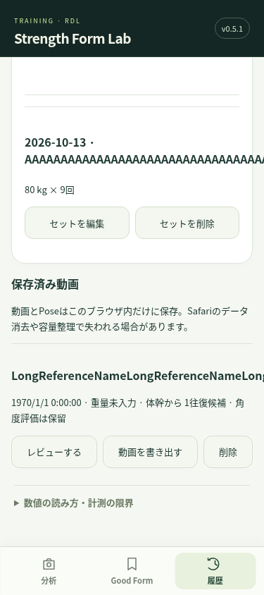
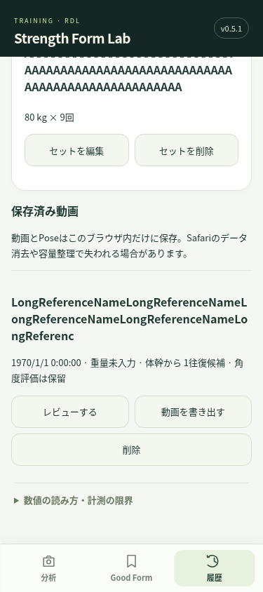

# Issue #13 — iPhone画面幅でのレイアウト修正（v0.5.1）

## 確認と再現

最新main `19154b6`、AGENTS.md、開発計画、Issue #13/#12/#8/#9、style.css/main.js/feedback-ui.js/workout-ui.jsを確認。今回の変更はCSS、日付labelの表示用class、アプリ版とレイアウトテストだけです。解析・助言・回数の確定/仮入力・保存処理は変更しません。

Chromiumで320/375/390/430pxの各画面幅を調査。長い英数字の記録名、80文字の自由種目名、長いお手本名・関連動画名を持つ合成データで、履歴を開くと横はみ出しを再現しました。375pxでdocument.scrollWidthが852px、修正後は375pxです。原因は長い文字列の折り返し不足と、Gridの1fr列/入力のintrinsic最小幅が列幅を広げること。表以外の記録名にも横はみ出しがありました。

実機の報告には機種/スクリーンショット/具体的な場所がないため、この再現がユーザーのSafari実機と同じ原因とは断定できません。

## 修正

- Grid列をminmax(0,1fr)、子要素/フォーム部品をmin-width:0に。長い語はoverflow-wrap:anywhereで折り返し、ページ全体をoverflow:hiddenで隠す対応はしない。
- 日付欄は全列を使い、ネイティブ日付入力の最小幅・表示幅を制約。入力16pxは維持。
- 横並びボタンに折り返し可能な基準幅と最大幅。320pxでは必要に応じて縦並び。固定3タブは維持。
- 横向きの左右safe-areaと下部バー右側の余白に対応。
- 動画高さを小さい画面の55svh以内に制限（最小140px）、vhの互換fallbackも追加。canvasは動画と同じ表示領域で既存ResizeObserverが更新。
- タイムラインも44px以上の操作高さ、入力/ボタンのscroll-marginで固定ヘッダー/バーの間へスクロール可能に。

## 検証

- npm ci（workspace内cache）成功。
- npm test：既存36件成功。
- Chromiumブラウザ：全16件成功（既存12件＋レイアウト4件）。追加4件はisMobile/hasTouch/DPR3の設定でも再実行して成功。
- npm run build：成功。
- 各320/375/390/430pxから横向き844×元幅へ変更し、長文、撮影設定、詳細/式/アドバイス、履歴、表、保存ボタン、動画再生、canvas表示サイズと描画バッファを確認。
- 文書幅<=画面幅、ボタン同士の重なりなし、表示中の操作対象44px以上、入力文字16px以上を確認。
- 高さ360pxの縮小画面で、入力/保存ボタンをスクロールし固定バーの外へ出せることを確認。safe-areaはCSSのenvをテスト用のtop20/bottom34/left44/right44pxへ置換して配置を模擬。
- タブの表示/非表示切替、日付/重量/回数の入力を確認。既存の動画解析・お手本・参考評価・保存/日誌回帰テストも成功。

WebKitの導入を試しましたがcdn.playwright.dev / playwright.download.prss.microsoft.comへの通信が403で、WebKitは実行できませんでした。Chromiumの画面幅変更はSafariそのものの検証ではありません。縮小画面はソフトウェアキーボード、模擬safe-areaは実際のノッチ/ブラウザバーを再現するものではありません。実機のキーボード・ピンチズーム・アドレスバー動作・iOS日付ピッカーは未確認です。

## before / after

375×844px、同じ合成記録を、mainの旧CSSと修正CSSで表示したもの。撮影動画・個人Pose・個人情報ではありません。画像は同じv0.5.1の画面でCSSだけを切り替えて撮影しています。

|mainのCSS（ページ852px）|修正CSS（ページ375px）|
|---|---|
|||

## 保存への影響

IndexedDB v3、sessions/summaries/workoutSets、Blob、Pose、Good Form、feedbackReports、回数検出、集計のコード/構成は変更なし。workout-ui.jsは日付のlabelへclassを追加しただけです。旧データの変換/削除/一括更新は行いません。バスケアプリ/DBにも触れません。

## Safari実機の再確認

1. 更新後v0.5.1を確認。以前崩れた画面を同じ端末・同じ記録で開き、横にページ全体が動かないことを確認。
2. 履歴で長い記録/種目名、動画の関連付け、日付入力、日誌の表を確認。表内の意図的なスクロールはページの横はみ出しと区別。
3. 撮影設定・計測詳細・参考評価の詳細を展開し、文字/入力/ボタンが画面内に収まることを確認。
4. 動画を再生し縦横を切り替え、骨格と映像の位置、保存ボタンまでのスクロールを確認。
5. 日誌の回数/重量/日付を入力し、キーボードが開いた状態・閉じた状態、アドレスバー展開/縮小、ノッチの左右を確認。
6. 3タブ切替・再読込で、動画/Pose/お手本/日誌の保持を確認。

まだ崩れる場合は機種、iOS版、縦/横、対象タブ/操作、スクリーンショットで残る原因を絞ります。実機で直ったという確認はまだ得られていません。

## 次のPRの順序・設計方針

1. **Issue #12：最重要の体験**。解析→「今回のセットを記録」→回数を仮入力（角度レップを優先、0なら動作候補、両方は合算しない）→±/直接入力で本人が修正→当日1セット保存。検出0/解析失敗でも手入力可能。元解析の推定数と日誌の本人確定数を別保存。同動画のunique indexを利用して重複保存では既存セット編集へ。動画を強制保存/複製しないため、元解析の保存要否を導線で明示する。
2. **Issue #8：参考角度・不足度数**。まず本人のお手本の対応する場面・角度定義・撮影条件に一致する項目で今回/基準/符号付き差を並べる。一般レンジは資料確認・2D角度への対応・指導者確認後に採用し、未校正の値と区別。xがレンジ[L,U]内なら差0、外なら近い境界までの度数と方向を表示。膝屈曲角とアプリの内角の定義/動作時点を照合。未観測関節には「あと○°」を作らない。骨盤後方移動の測定は固定カメラ等の条件を設けて別途検証し、「お尻を後ろへ」は一般キューと観測した欠点断定を区別。新評価版を別保存。
3. **Issue #9：全面UI修正**。フォーム目安・次セットの助言・仮回数修正/当日記録を主要導線として配置し、数値やモデル等は詳細へ。今回の4画面幅テストを退行チェックに利用。タブ/音声/エラー/旧履歴も含む変更前後の文言表を作る。

今回は2/3の解析や自動入力を実装せず、それぞれ別の目的のPRに分けます。マージ・公開・自動マージは行いません。
